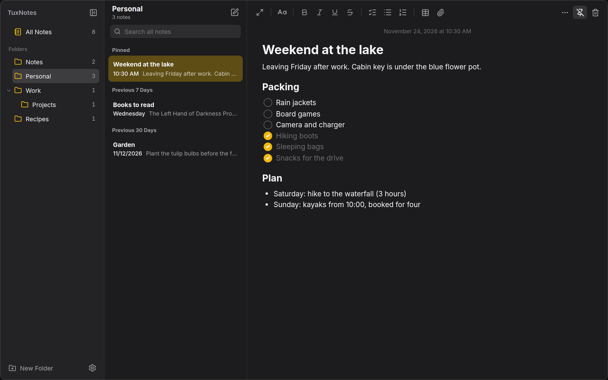
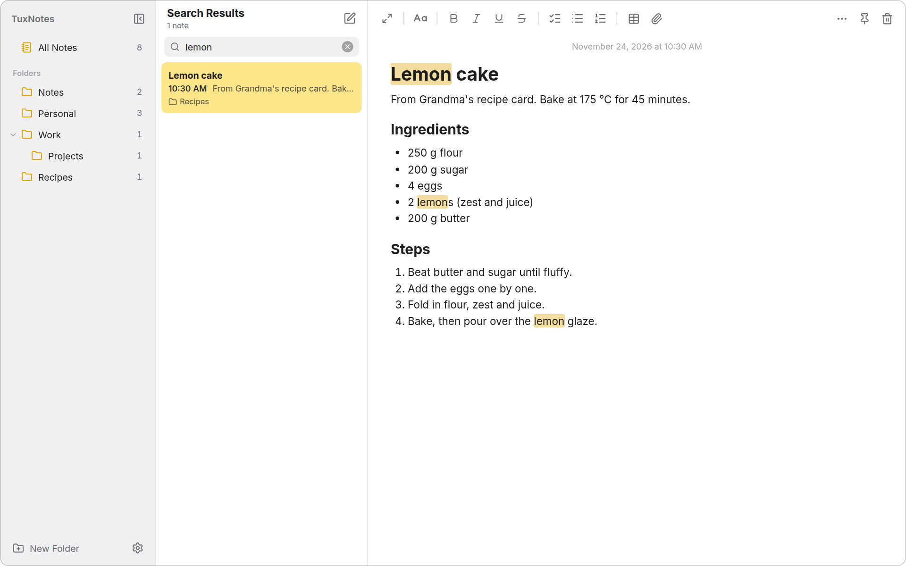

# TuxNotes

[](https://github.com/Rick8509/TuxNotes/releases/latest)
[](https://github.com/Rick8509/TuxNotes/actions/workflows/checks.yml)
[](LICENSE)

**Open notes for Linux.** A lightweight, local-first notes app with a clean three-pane design inspired by Apple Notes.


<p align="center">
  
  
</p>

## Install

Download the file for your Linux from the **[latest release](https://github.com/Rick8509/TuxNotes/releases/latest)** (under *Assets*), then install it:

| Your Linux | File | Install with |
|---|---|---|
| Ubuntu, Debian, Linux Mint, Pop!_OS, elementary OS, Zorin | `TuxNotes_<version>_amd64.deb` | `sudo apt install ./TuxNotes_*_amd64.deb` |
| Fedora, openSUSE, RHEL, AlmaLinux, Rocky | `TuxNotes-<version>-1.x86_64.rpm` | `sudo dnf install ./TuxNotes-*.x86_64.rpm` (openSUSE: `sudo zypper install ./TuxNotes-*.x86_64.rpm`) |
| Any other (Arch, Manjaro, …) | `TuxNotes_<version>_amd64.AppImage` | `chmod +x TuxNotes_*_amd64.AppImage` then run it |

Run the command in the folder you downloaded to (usually `cd ~/Downloads` first). On Ubuntu and Fedora you can also double-click the file to install it with the Software app. TuxNotes then appears in your app menu.

- **Requirements:** a 64-bit PC (x86-64) with a recent distribution: Ubuntu 22.04 or Debian 12 and newer, Fedora 38 and newer.
- **Updating:** download the new version and install it the same way. Your notes are kept.
- **Uninstalling:** `sudo apt remove tux-notes` or `sudo dnf remove tux-notes` (AppImage: delete the file). Your notes stay in `~/.local/share/io.github.Rick8509.TuxNotes/` until you delete that folder.
- **Checking a download** (optional): every release lists SHA-256 checksums in `SHA256SUMS.txt` (`sha256sum -c SHA256SUMS.txt --ignore-missing`), and each file has a signed record that it was built from this repository by GitHub Actions (`gh attestation verify <file> --repo Rick8509/TuxNotes`).

## Features

- Three panes: folders, note list and editor
- Rich text: title, heading and subheading styles, bold, italic, underline, strikethrough, monospaced blocks, quotes
- **Slash commands**: type `/` to insert headings, checklists, lists, tables, images and files, links, dividers or today's date from a menu at the cursor; keep typing to filter ("todo", "h2", "img")
- **Spell checking** while typing, in one or more languages (Settings → General → Spelling); right-click a misspelled word for suggestions. Uses the installed Hunspell dictionaries (e.g. `sudo apt install hunspell-en-us`)
- **Files window**: open text and code files (Open With → TuxNotes, `tuxnotes file.txt`, drag and drop, or Ctrl+O) in tabs, separate from your notes
- Checklists with round checkboxes (ticked items move to the bottom; right-click for Check All, Uncheck All, Delete Checked Items), plus bulleted and numbered lists
- **Tables**: insert from the toolbar, right-click a cell to add or remove rows and columns, Tab between cells, drag borders to resize columns
- **Export and import**: save a note as Markdown (attachments are copied next to it) or as a PDF, print it, and import Markdown files as notes (checklists, tables and images included). All from the **⋯** button in the editor
- **Images and attachments**: paste a screenshot, drag in files, or use the paperclip button. Images show in the note; other files appear as chips you can open (double-click) or save a copy of. Attachments are included in backups
- Pinned notes, folders with **subfolders** (drag folders to nest or reorder them), and **Recently Deleted** (notes are removed permanently after 30 days)
- **Undo** right after deleting a note, **duplicate** notes, and **Note Info** (word count, dates, folder)
- **Password-locked notes**: lock any note from its ⋯ menu; its text is encrypted until you enter the password (see [Locked notes](#locked-notes))
- Fast full-text search that ignores accents ("cafe" finds "café"); matches are highlighted in the open note, and **Find in note** (`Ctrl+F`) steps through matches
- **Google Drive backup and restore**: manual or automatic (daily/weekly), keeps the last N backups, and restores on any computer. TuxNotes can only see files it created. *Not in the release builds yet; see [Google Drive backup](#google-drive-backup).*
- Rounded, borderless window. Hide the sidebar, use focus mode to hide both side panes, and drag the dividers to resize them; the window remembers its size and layout
- Notes grouped like Apple Notes (Pinned, Today, Yesterday, Previous 7 Days, …); drag a note onto a folder to move it
- **Settings** (`Ctrl+,`): sort notes by date edited, date created or title; date grouping on or off; how new notes start; System, Light or Dark theme; editor text size
- Autosave, keyboard-first workflow
- Small and fast: built with [Tauri](https://tauri.app) and stored in a single SQLite file

### Keyboard shortcuts

| Action | Shortcut |
|---|---|
| Insert anything (slash commands) | `/` at the start of a line or after a space |
| New note | `Ctrl+N` |
| Settings | `Ctrl+,` |
| Print the open note | `Ctrl+P` |
| New folder | `Ctrl+Shift+N` |
| Find in the open note | `Ctrl+F` (while typing in a note) |
| Search all notes | `Ctrl+Shift+F` (or `Ctrl+F` elsewhere) |
| Delete note | `Ctrl+Delete` |
| Checklist | `Ctrl+Shift+L` |
| Title / Heading / Subheading / Body | `Ctrl+Shift+T` / `H` / `J` / `B` |
| Bold / Italic / Underline / Strikethrough | `Ctrl+B` / `I` / `U` / `Ctrl+Shift+S` |
| Show/hide sidebar | `Ctrl+Alt+S` |
| Focus mode (hide sidebar and note list) | `Ctrl+Alt+F` |
| Full screen | `F11` |
| Zoom in / out | `Ctrl+=` / `Ctrl+-` |
| Open the selected note for typing (in the note list) | `Enter` or `Tab` |
| Delete the selected note (in the note list) | `Delete` |
| Add or edit a link | `Ctrl+K` |
| Open a link in your browser | `Ctrl+click` |
| Next / previous table cell (Tab in the last cell adds a row) | `Tab` / `Shift+Tab` |

## Where are my notes?

Everything is stored locally in `~/.local/share/io.github.Rick8509.TuxNotes/`: `notes.db` (SQLite) and an `attachments/` folder for images and files. Settings live in `~/.config/io.github.Rick8509.TuxNotes/settings.json`.

Before a restore, TuxNotes saves a copy of your current notes in `~/.local/share/io.github.Rick8509.TuxNotes/safety/`.

## Locked notes

Choose **Lock Note…** in a note's ⋯ menu (or right-click it in the list). The first time, you pick a password; one password covers all your locked notes.

- A locked note's text is encrypted with XChaCha20-Poly1305. The key that encrypts it is itself protected by your password through Argon2id, which makes guessing passwords slow. Neither your password nor the key is ever saved unencrypted.
- Locked notes stay open until you click the open padlock (**Lock Now**), after a period without using TuxNotes (**Settings → General**, 10 minutes by default), or when TuxNotes closes.
- Backups contain locked notes still encrypted, so they need the same password after a restore.
- **There is no way to recover a forgotten password.** You can add a hint.

What locking doesn't hide: the note's **title** (its first line) stays visible in the list and in search, and **images and files** in a locked note are stored unencrypted. Backups made *before* you locked a note still contain it unlocked.

## Google Drive backup

Open **Settings** (the gear at the bottom of the sidebar, or `Ctrl+,`) → **Backup**, then click **Back Up to Google Drive** or **Restore from Google Drive**. TuxNotes asks before opening your browser to sign in with Google; once you've allowed access, it does the backup (and turns on daily automatic backups), or shows your backups to restore.

- **Encrypt backups** (Settings → Backup): backups are encrypted on your computer before they're uploaded (XChaCha20-Poly1305, with the key derived from your password by Argon2id). TuxNotes keeps that key in your system keyring so automatic backups keep working; the password itself is never stored. Restoring on another computer asks for the password. Encrypted backups don't even show how many notes they hold. **A forgotten backup password can't be recovered.**
- **Back up when closing** (on by default): if anything changed since the last backup, closing TuxNotes hides the window right away and finishes a backup first (for up to 90 seconds).

> **Not in the release builds yet.** Google sign-in needs a Google Cloud project for TuxNotes, which isn't set up yet, so the downloads from the Releases page show "Google Drive backup isn't available" in Settings → Backup. It will come in a later version. Until then, back up by copying `~/.local/share/io.github.Rick8509.TuxNotes/` while TuxNotes is closed.

To use Drive backup now, build TuxNotes yourself with your own (free) Google OAuth client: see [docs/google-setup.md](docs/google-setup.md).

## Building from source

### 1. Install the requirements (Debian/Ubuntu)

```bash
sudo apt install libwebkit2gtk-4.1-dev libgtk-3-dev libayatana-appindicator3-dev \
  librsvg2-dev libssl-dev libxdo-dev build-essential curl wget file
curl --proto '=https' --tlsv1.2 -sSf https://sh.rustup.rs | sh   # Rust 1.90 or newer
# Node.js 20+ is also required
```

For Fedora, Arch and other distributions, see the [Tauri prerequisites](https://v2.tauri.app/start/prerequisites/#linux).

### 2. Run it in development mode

```bash
npm install            # first time only, and after dependencies change
npm run app:dev        # runs "TuxNotes Dev", with its own notes
```

`npm run app:dev` runs **TuxNotes Dev**: the same app with its own app ID (`io.github.Rick8509.TuxNotes.Dev`), notes folder, settings and keyring entries, a DEV badge and an orange DEV icon. Your real notes in TuxNotes are never touched. (`npm run tauri dev` still runs it as TuxNotes, with your real notes.)

Leave it running while you work:

- Changes in `src/` (the interface) appear in the window almost instantly, with no restart.
- Changes in `src-tauri/` or `crates/` (Rust) make it recompile and restart the app automatically (usually 5–20 s).

The first build takes a few minutes; later builds are incremental.

### 3. Build installable packages

To try your changes as an installed app, build **TuxNotes Dev**. It installs next to TuxNotes (package `tux-notes-dev`, command `tuxnotes-dev`) and keeps its own notes:

```bash
npm run build:dev -- --bundles deb   # only the .deb (fastest); without it: .deb, .rpm and AppImage
sudo apt install ./target/release/bundle/deb/TuxNotes\ Dev_*_amd64.deb
```

Its version is the current one plus `-dev.<number of commits>` (for example `0.1.0-dev.84`), so each new build installs over the previous one. You can also let GitHub build it: **Actions → Build and Publish → Run workflow** (from `dev`, *Dev build* ticked), then download the packages from the run.

The real app is built the same way without the Dev settings (`npx tauri build`); releases do that automatically (see [Releasing](#releasing)). Rebuilding or reinstalling never touches your notes, which live in `~/.local/share/io.github.Rick8509.TuxNotes/` (TuxNotes Dev: `~/.local/share/io.github.Rick8509.TuxNotes.Dev/`).

### Working on the UI without Rust

`npm run dev` serves the interface at http://localhost:1420 in a normal browser. A built-in mock backend stores data in `localStorage`, so no Rust toolchain is needed.

## Project layout

```
crates/tuxnotes-core/   Storage engine: SQLite, migrations, search, trash, backup archives (no GUI deps)
crates/tuxnotes-gdrive/ Google sign-in (loopback + PKCE) and Google Drive v3 client
src-tauri/              Desktop shell: window and IPC commands that call tuxnotes-core
src/                    Svelte 5 + TipTap user interface
```

## Development checks

Run these before committing. GitHub runs the same checks (the **Checks** workflow) on every push to `dev` and `main` and on pull requests. Pull requests go to `dev`; `main` only receives releases.

```bash
cargo fmt --all                   # format Rust code
cargo test --workspace            # storage, Drive client and app tests
cargo clippy --workspace --all-targets -- -D warnings
npm run check && npm test         # typecheck + frontend unit tests
npm run test:e2e                  # browser tests (tests/e2e) against the browser preview
```

The browser tests drive the app in Google Chrome or Chromium with the mock backend (`src/lib/mock.ts`). Set `CHROME=/path/to/chrome` if it isn't found, and `npm run test:e2e -- ctrl-delete` runs only the matching test files.

## Releasing

Releases are published from GitHub with one click: **Actions → Prepare Release → Run workflow**, then merge the pull request it opens. The packages are built, signed and published automatically. The full playbook, including dev builds and what to do when something fails, is in [docs/RELEASING.md](docs/RELEASING.md).

## Roadmap

- [x] Folders, notes, rich text, checklists, search, pinning, Recently Deleted
- [x] Tables, images and attachments, Markdown and PDF export, subfolders, locked notes
- [x] Backup to and restore from Google Drive, automatic and encrypted (in builds with Google sign-in)
- [ ] Google sign-in in the official release builds
- [ ] A notice in the app when a new version is out
- [ ] Flathub

## License

[MIT](LICENSE)
