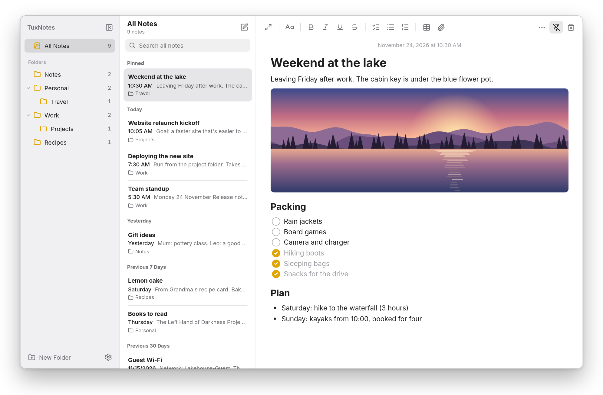
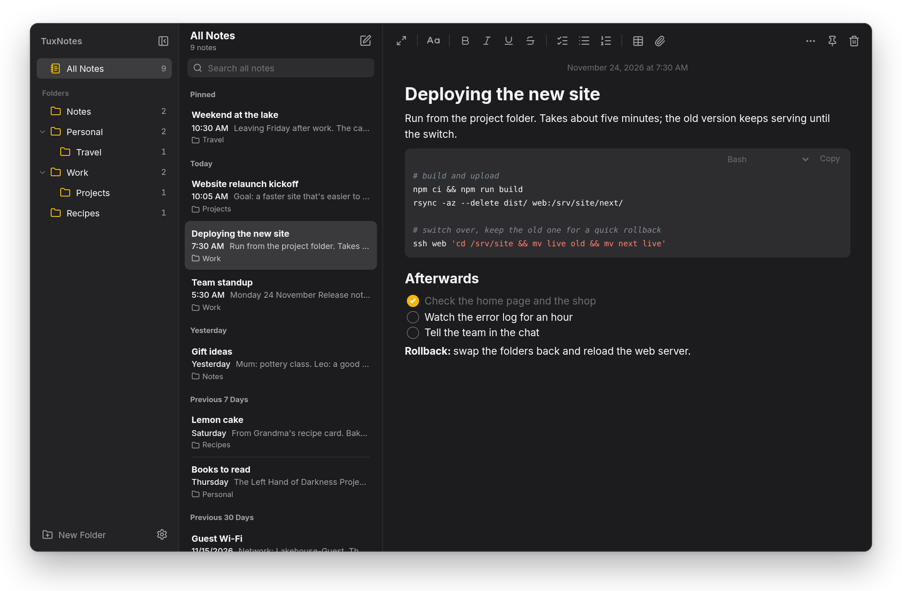
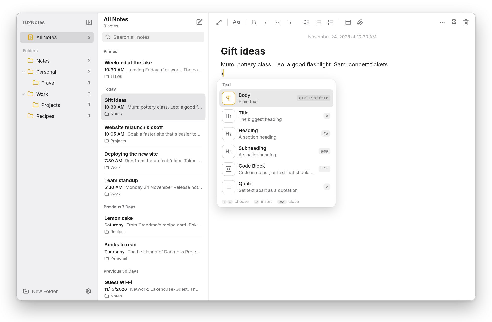
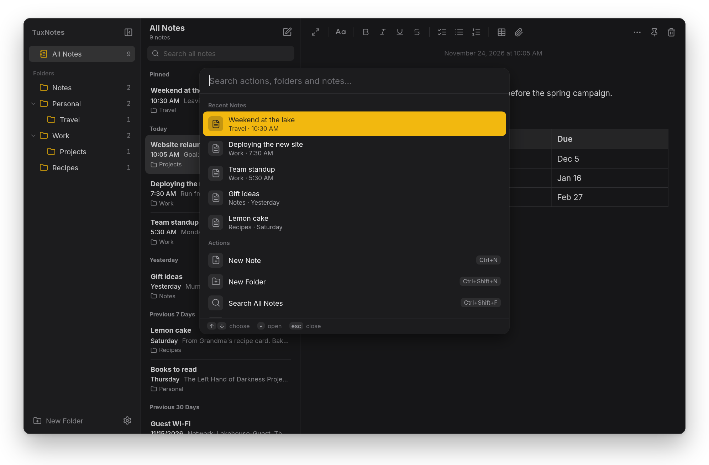
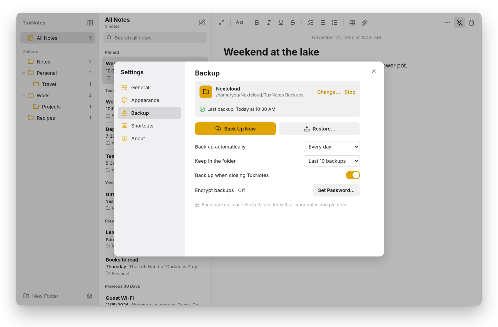
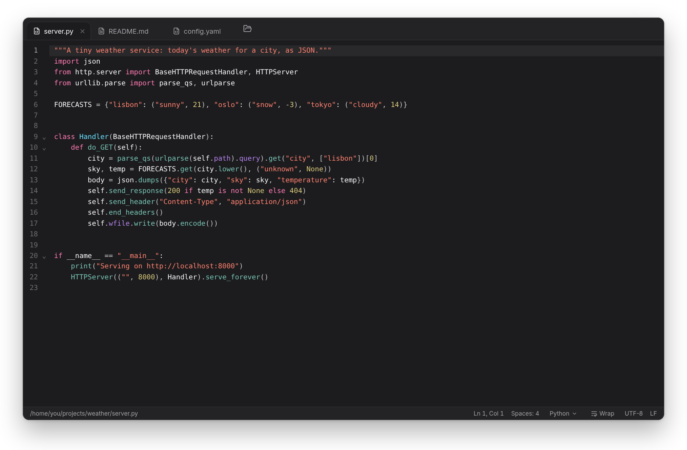
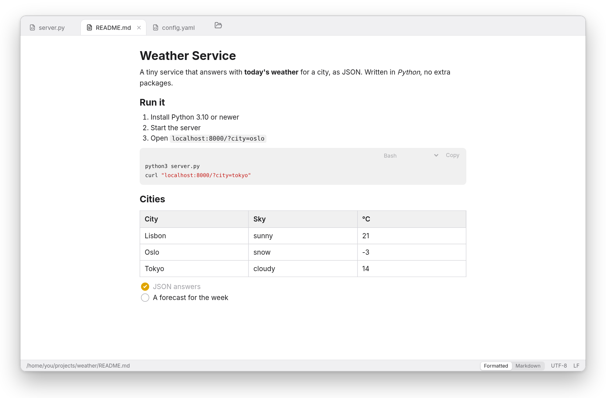

<div align="center">


# TuxNotes

**A fast, private notes app for Linux.**<br>
Folders, checklists, tables, pictures and code, saved as you type on your own computer. No account needed.

[](https://github.com/Rick8509/TuxNotes/releases/latest)
[](https://github.com/Rick8509/TuxNotes/actions/workflows/checks.yml)
[](LICENSE)


[**Download**](https://github.com/Rick8509/TuxNotes/releases/latest) · [Features](#features) · [Screenshots](#screenshots) · [Install](#install) · [Contributing](CONTRIBUTING.md)

</div>



## Why TuxNotes

- **Your notes stay yours.** They're kept in one file on your computer and work offline. No account, no cloud you didn't choose, no tracking.
- **Clean and quick.** Three panes inspired by Apple Notes, a shortcut for everything, and a command palette for the rest.
- **Safe.** Lock private notes with a password, and back up automatically to a USB drive or a synced folder, encrypted if you like.
- **More than notes.** Open text, code and Markdown files in a tabbed editor with syntax colours.

## Features

### Write
- Titles, headings, **bold**, *italic*, underline, strikethrough, quotes, links and dividers
- Checklists that move ticked items to the bottom, plus bulleted and numbered lists
- Tables: add and remove rows and columns, merge cells, resize columns
- Code blocks with colours for about 35 languages and a Copy button
- **Slash commands**: type `/` to insert a heading, checklist, table, picture, today's date and more
- Pictures and files: paste a screenshot or drag files in; resize, crop and rotate pictures
- Spell checking in one or more languages

### Organize and find
- Folders and subfolders (drag to nest and reorder), pinned notes, and date sections like Apple Notes
- Recently Deleted keeps notes for 30 days, and Undo brings back a note you just deleted
- Instant search across all notes that ignores accents, with the matches highlighted; find in the open note
- **Command palette** (`Ctrl+Shift+P`): every action, folder and note in one search box

### Private and safe
- **Locked notes**, encrypted with your password (XChaCha20-Poly1305, Argon2id)
- **Backups** to any folder: a USB drive, or one that Nextcloud, Dropbox or Syncthing keeps in sync. Daily or weekly, keeps the last N, optionally encrypted, and restores on any computer
- No account and no telemetry. The only thing TuxNotes asks the internet is whether a new version is out, once a day, and you can switch that off

### Files window
- Open text and code files from your file manager (**Open With → TuxNotes**), the terminal (`tuxnotes notes.txt`) or with `Ctrl+O`
- Tabs, syntax colours for about 140 languages, line numbers, folding and word wrap
- Saves safely, keeps each file's encoding and line endings, and notices changes made by other programs
- Markdown files open as a formatted page you can edit like a note; saving changes only what you edited

### And also
- Export a note as Markdown or PDF, print it, and import Markdown files
- Light and dark look (or follow your desktop), and adjustable text size
- Rounded, borderless window, focus mode, and it remembers its size and layout

## Screenshots

<table>
  <tr>
    <td width="50%"><br><sub><b>Dark look</b>, with a code block in colour</sub></td>
    <td width="50%"><br><sub><b>Slash commands</b> insert anything at the cursor</sub></td>
  </tr>
  <tr>
    <td><br><sub><b>Command palette</b>: every action, folder and note</sub></td>
    <td><br><sub><b>Backups</b> to a USB drive or a synced folder</sub></td>
  </tr>
  <tr>
    <td><br><sub><b>Files window</b> for text and code files</sub></td>
    <td><br><sub><b>Markdown files</b> as a page you can edit</sub></td>
  </tr>
</table>

## Install

Download the file for your Linux from the **[latest release](https://github.com/Rick8509/TuxNotes/releases/latest)** (under *Assets*), then install it:

| Your Linux | File | Install with |
|---|---|---|
| Ubuntu, Debian, Linux Mint, Pop!_OS, elementary OS, Zorin | `TuxNotes_<version>_amd64.deb` | `sudo apt install ./TuxNotes_*_amd64.deb` |
| Fedora, openSUSE, RHEL, AlmaLinux, Rocky | `TuxNotes-<version>-1.x86_64.rpm` | `sudo dnf install ./TuxNotes-*.x86_64.rpm` (openSUSE: `sudo zypper install …`) |
| Any other (Arch, Manjaro, …) | `TuxNotes_<version>_amd64.AppImage` | `chmod +x TuxNotes_*.AppImage`, then run it |

Run the command in the folder you downloaded to (usually `cd ~/Downloads` first), or double-click the file to install it with your Software app. TuxNotes then appears in your app menu.

- **Requirements:** a 64-bit PC (x86-64) with Ubuntu 22.04, Debian 12, Fedora 38 or newer.
- **Updating:** install the new version the same way. Your notes are kept, and TuxNotes tells you when a new version is out.
- **Uninstalling:** `sudo apt remove tux-notes` or `sudo dnf remove tux-notes` (AppImage: delete the file). Your notes stay until you delete their folder (see [Your notes](#your-notes)).

<details>
<summary><b>Checking a download</b> (optional)</summary>

Every release lists SHA-256 checksums in `SHA256SUMS.txt` (`sha256sum -c SHA256SUMS.txt --ignore-missing`), and each file has a signed record that GitHub built it from this repository: `gh attestation verify <file> --repo Rick8509/TuxNotes`.
</details>

## Getting started

- **`Ctrl+N`** makes a new note. Its first line is the title; everything is saved as you type.
- **Type `/`** at the start of a line to insert a checklist, table, picture, code block or the date.
- **`Ctrl+Shift+P`** finds any action, folder or note. **`Ctrl+Shift+F`** searches all notes.
- **Right-click** notes, folders, pictures, checklists and table cells for what you can do with them.
- **Settings** (`Ctrl+,`) → **Backup** → **Back Up to a Folder…** keeps a copy of your notes safe.

<details>
<summary><b>Keyboard shortcuts</b></summary>

| Action | Shortcut |
|---|---|
| Command palette: any action, folder or note | `Ctrl+Shift+P` |
| Insert anything (slash commands) | `/` at the start of a line or after a space |
| New note / new folder | `Ctrl+N` / `Ctrl+Shift+N` |
| Search all notes | `Ctrl+Shift+F` (or `Ctrl+F` outside a note) |
| Find in the open note | `Ctrl+F` (while typing in a note) |
| Delete note | `Ctrl+Delete` (or `Delete` in the note list) |
| Print the open note | `Ctrl+P` |
| Settings | `Ctrl+,` |
| Open a text or code file | `Ctrl+O` |
| Title / Heading / Subheading / Body | `Ctrl+Shift+T` / `H` / `J` / `B` |
| Bold / Italic / Underline / Strikethrough | `Ctrl+B` / `I` / `U` / `Ctrl+Shift+S` |
| Checklist | `Ctrl+Shift+L` |
| Add or edit a link / open a link | `Ctrl+K` / `Ctrl+click` |
| Next / previous table cell (a new row in the last cell) | `Tab` / `Shift+Tab` |
| Open the selected note for typing (in the note list) | `Enter` or `Tab` |
| Show or hide the sidebar / focus mode | `Ctrl+Alt+S` / `Ctrl+Alt+F` |
| Full screen / zoom in / zoom out | `F11` / `Ctrl+=` / `Ctrl+-` |
| Files window: save / save as / close tab / next tab | `Ctrl+S` / `Ctrl+Shift+S` / `Ctrl+W` / `Ctrl+Tab` |
| Files window: wrap lines / Markdown as page or text | `Alt+Z` / `Ctrl+Shift+M` |

All of them are also in **Settings → Shortcuts**.
</details>

## Your notes

Everything is stored on your computer in `~/.local/share/io.github.Rick8509.TuxNotes/`: `notes.db` (an SQLite database) and an `attachments/` folder for pictures and files. Settings are in `~/.config/io.github.Rick8509.TuxNotes/`. Before a restore, TuxNotes keeps a copy of your current notes in the `safety/` folder there.

### Locked notes

Choose **Lock Note…** in a note's **⋯** menu (or right-click it in the list). One password covers all locked notes, with an optional hint. A locked note's text is encrypted with XChaCha20-Poly1305, with the key protected by your password through Argon2id; neither is ever saved unencrypted. Locked notes lock again when you click the padlock, after a while without using TuxNotes (Settings → General), and when TuxNotes closes.

Good to know: a locked note's **title** (its first line) stays visible in the list and in search, **pictures and files** in it aren't encrypted, and **a forgotten password can't be recovered**.

### Backups

**Settings** (`Ctrl+,`) → **Backup** → **Back Up to a Folder…**, and choose a folder on a USB drive or one that Nextcloud, Dropbox or Syncthing keeps in sync. TuxNotes makes a **TuxNotes Backups** folder in it and backs up right away, then daily or weekly, and when you close it if anything changed. Each backup is one file with all your notes and pictures, written in full before it appears, so a sync program never picks up half a backup. While a USB drive is unplugged, backups wait for it.

- **Encrypt backups** with a password (XChaCha20-Poly1305, Argon2id). TuxNotes keeps the key in your system keyring so automatic backups keep working; the password itself isn't stored, and a forgotten one can't be recovered.
- **Restore** from the same screen. On a new computer, choose **Restore from a folder** and pick the folder with your backups.
- **Google Drive** backups are built in too, but need Google sign-in, which the release downloads don't include yet. If you build TuxNotes yourself, see [docs/google-setup.md](docs/google-setup.md).

## Contributing

Bug reports, ideas and code are all welcome.

- **Found a bug or have an idea?** [Open an issue](https://github.com/Rick8509/TuxNotes/issues/new/choose).
- **Found a security problem?** Please report it privately: see [SECURITY.md](SECURITY.md).
- **Want to work on the code?** [CONTRIBUTING.md](CONTRIBUTING.md) explains how to build and run TuxNotes, how the code is organized, the tests, and how releases are made.

```bash
git clone https://github.com/Rick8509/TuxNotes.git && cd TuxNotes
npm install
npm run app:dev        # runs "TuxNotes Dev", with its own notes
```

## License

TuxNotes is free software under the [MIT License](LICENSE). It's built with [Tauri](https://tauri.app), [Svelte](https://svelte.dev), [TipTap](https://tiptap.dev), [CodeMirror](https://codemirror.net) and [SQLite](https://sqlite.org).
